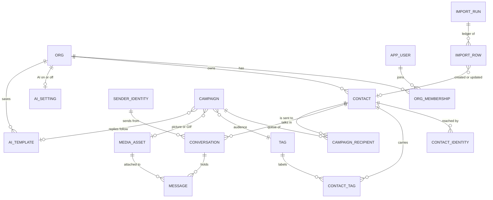

# 35 · The database, its optimisations and its main queries

Written 2026-10-21 for Kushal's own reference. Everything here is taken from the code and the live
database; where something is **not** done yet it says so (section 5).

- **Every table, column, key, index, policy and trigger** is in the generated
  [`generated/database-reference.md`](generated/database-reference.md) (plain Markdown) and
  [`generated/schema.html`](generated/schema.html) (an interactive diagram). Regenerate both with
  `npm run db:docs` after a migration. The tables are **explained in plain words** in
  `packages/db/src/table-notes.ts`; a test (`tests/integration/table-notes.test.ts`) fails if a new
  table has no note.
- The older [`05-data-model.md`](05-data-model.md) explains why the columns exist.

## 1 · The shape in one picture



**The 32 tables, by group** (one line each; the generated reference has the rest):

| Group | Tables |
|---|---|
| Workspaces and people | `org`, `app_user`, `org_membership`, `session`, `api_key` |
| Contacts | `contact`, `contact_identity`, `tag`, `contact_tag`, `custom_field`, `segment` |
| Inbox | `conversation`, `message`, `media_asset`, `internal_note`, `canned_reply`, `conversation_participant`, `conversation_presence` |
| WhatsApp numbers | `sender_identity`, `channel_session`, `channel_auth_state` |
| Campaigns | `campaign`, `campaign_recipient`, `ai_setting`, `ai_template`, `ai_job` |
| Import | `import_run`, `import_row` |
| Audit and health | `audit_log`, `ai_run`, `key_rotation_state`, `sender_health_event` |

That is 32 tables. A person's number or email is not on `contact`: it is a row in `contact_identity`
(kinds `phone`, `email`, `wa_jid`, `wa_lid`, …), so one person can have several ways to be reached.

## 2 · How tenancy (one org never sees another) works

- Every tenant table has `org_id NOT NULL` and a **row-level-security policy**:
  `org_id = current_setting('app.org_id', true)::uuid`. 28 policies, and `FORCE ROW LEVEL SECURITY` so
  even the table owner is held to it.
- A request runs inside a transaction that does `SET LOCAL ROLE crm_app` (a restricted role with no
  `BYPASSRLS`) and `set_config('app.org_id', …)`. A query that forgets `WHERE org_id = …` returns **no
  rows** instead of someone else's. Code: `apps/api/src/tenant.ts`, `apps/gateway/src/tenant.ts`,
  `packages/db/src/security-check.ts` (it checks at boot that the role cannot bypass).
- The audit log is append-only for the app role (`REVOKE UPDATE, DELETE`).
- **Files are the exception row-level security cannot reach**: bytes live on disk (or a bucket), so
  `resolveMedia` walks media → message → conversation → org by hand, and a campaign picture is
  authorised by `media_asset.campaign_picture` for the same org (`resolveCampaignPicture`).
- Three triggers and two functions exist, all for the gateway: `notify_gateway()` fires on a queued
  message and on link or unlink requests so the gateway wakes at once (`LISTEN/NOTIFY`), and
  `envelope_key_version()` backs an index used by key rotation.

## 3 · Optimisations that are implemented

| What | Where | Why it matters |
|---|---|---|
| **One lookup per person, per org, unique.** `UNIQUE (org_id, kind, value_normalized)` on `contact_identity` | `contact_identity_lookup_uidx` | Importing or receiving a message finds the existing person in one index probe, and the database itself refuses a duplicate. Phone and email are *identities* attached to a permanent contact id, so changing a number never changes the id. |
| **Same file never stored or imported twice** (SHA-256) | `media_asset_digest_idx`, `import_run_digest_uidx` (partial, `WHERE superseded_at IS NULL`) | A CV forwarded into five chats is stored once; the same spreadsheet cannot be imported twice. |
| **Import ledger is resumable and idempotent** | `import_row_number_uidx (import_run_id, row_number)` | A killed import restarts from the last committed batch; a retried commit changes nothing twice. |
| **Campaign recipients are the queue** | `campaign_recipient_pending_idx (campaign_id, status)`, `campaign_recipient_uidx (campaign_id, contact_id)` | The gateway pulls only `pending` rows. A person can never be in one campaign twice. |
| **Safe concurrent dispatch** | `FOR UPDATE … SKIP LOCKED` in `dispatchCampaign` | Two sweeps never claim the same recipient; no waiting, no double message. |
| **Only the queued outbound messages are indexed** | `message_queued_idx (created_at) WHERE direction='outbound' AND status='queued'` | A partial index stays tiny while the table grows; the send sweep reads it directly. |
| **Thread reads in order** | `message_conversation_idx (conversation_id, created_at)` | Opening a chat is an index range scan. |
| **Provider ids are unique** | `message_provider_id_uidx (org_id, provider_message_id)` | A message WhatsApp delivers twice is stored once. |
| **One conversation per contact per number** | `conversation_contact_sender_uidx` | A campaign message lands in the existing thread, not a parallel one. |
| **Tag filtering both ways** | `contact_tag (contact_id, tag_id)` primary key + `contact_tag_tag_idx (tag_id)` | "Who has this tag" and "which tags has this person" are both indexed. |
| **Custom fields searchable** | `contact_custom_fields_gin` (GIN, `jsonb_path_ops`) | A field value (city, skill) can be searched without a table scan of the JSON. |
| **Whole-book tagging in one statement** | `bulkTag` (`INSERT … SELECT … ON CONFLICT DO NOTHING`) | Tagging 50,000 people is one set-based statement, idempotent, not 50,000 round trips. The same rule (`searchPredicate`) resolves the list, the count and the bulk action, so "what you see" is "what gets tagged". |
| **Progress in one pass** | `campaignProgress` uses `count(*) FILTER (WHERE …)` | All six status counts in one scan instead of six queries. |
| **A list page is one query, not N+1** | `GET /contacts` builds `identities` and `tags` with correlated `json_agg` subselects | 50 contacts with their numbers and tags in one round trip. |
| **Keyset paging, not offsets** | `GET /contacts?cursor=` on `created_at` | Page 500 costs the same as page 1 (newest-added order only; other orders return the first page). |
| **No per-row tag dropdowns** | one shared `<datalist id="all-tags">` on the Contacts page | The page was 5.7 MB at 50 people and 129 tags before; now it does not grow with people × tags. |
| **Encrypted bodies still searchable for duplicates** | `message.body_hmac` (a blind index from the KMS) | Duplicate and search checks compare HMACs without decrypting. |
| **Safe previews, small and cacheable** | `GET /media/:id/thumb`: decoded and re-encoded to 320 px WebP (`sharp`), `Cache-Control: private, max-age=3600` | Lists show pictures at a few KB each, and the original is never shown inline. |
| **GIFs are converted once, at upload** | `storeCampaignPicture` runs ffmpeg and stores the clip next to the GIF (`source_asset_id`) | Sending never waits on a conversion; every recipient gets the stored clip. |
| **Same picture, one stored copy** | the campaign picture path reuses `storeOutboundMedia`'s SHA-256 dedupe | Re-uploading the same offer image is free. |
| **Page data fetched in parallel** | `Promise.all` in the AI, Contacts and campaign pages | One wait instead of four. |
| **Generation is rate-limited per organisation** | 5 a minute in `routes/ai.ts`; description capped at 8,000 characters | Protects the model provider's limits and the bill. |
| **One AI request at a time per org** | `ai_job` queue | A slow or rate-limited model never gets several at once. |
| **Counts are separate and cheap** | `GET /contacts/count` | The bulk-tag preview and "Check how many" do not fetch rows. |

## 4 · The main queries (as they are in the code)

**Find a person by phone or email (import and inbound).** `packages/core/src/ingestion.ts`
```sql
SELECT contact_id FROM contact_identity
WHERE org_id = $1 AND kind = $2 AND value_normalized = $3 LIMIT 1;   -- unique index, one probe
```

**The contact list: search, tag, date range (added or last imported), order.** One shared rule,
`searchPredicate` in `packages/core/src/tagging.ts`, used by the list, the count and bulk tagging:
```sql
c.org_id = $org AND c.deleted_at IS NULL
AND ($q IS NULL OR c.display_name ILIKE $like
     OR EXISTS (SELECT 1 FROM jsonb_each_text(c.custom_fields) cf WHERE cf.value ILIKE $like)
     OR EXISTS (SELECT 1 FROM contact_identity ci2 WHERE ci2.contact_id = c.id AND ci2.value_normalized ILIKE $like))
AND ($tag IS NULL OR EXISTS (SELECT 1 FROM contact_tag ct2 WHERE ct2.contact_id = c.id AND ct2.tag_id = $tag))
AND (dates unset
     OR (added    AND c.created_at >= $from AND c.created_at < $to + 1)
     OR (imported AND EXISTS (SELECT 1 FROM import_row ir JOIN import_run r ON r.id = ir.import_run_id
                              WHERE ir.contact_id = c.id AND r.created_at >= $from AND r.created_at < $to + 1)))
```
Order options: `c.created_at DESC|ASC`, `lower(c.display_name) ASC`, or the latest import
(`(SELECT max(r.created_at) FROM import_row ir JOIN import_run r … WHERE ir.contact_id = c.id) DESC`).

**Tag everyone a search finds (one statement).** `bulkTag`
```sql
WITH ins AS (
  INSERT INTO contact_tag (org_id, contact_id, tag_id)
  SELECT $org, c.id, $tag FROM contact c WHERE <the same predicate>
  ON CONFLICT (contact_id, tag_id) DO NOTHING RETURNING 1)
SELECT count(*)::int FROM ins;
```

**Campaign progress.** `campaignProgress`
```sql
SELECT count(*) AS total,
       count(*) FILTER (WHERE status='pending') AS pending, count(*) FILTER (WHERE status='queued') AS queued,
       count(*) FILTER (WHERE status='sent') AS sent, count(*) FILTER (WHERE status='failed') AS failed,
       count(*) FILTER (WHERE status='skipped') AS skipped
FROM campaign_recipient WHERE campaign_id = $1 AND org_id = $2;
```

**Dispatch: turn pending recipients into queued messages (safe under concurrency).** `dispatchCampaign`
```sql
SELECT cr.id, cr.contact_id, c.display_name, c.custom_fields
FROM campaign_recipient cr JOIN contact c ON c.id = cr.contact_id AND c.org_id = cr.org_id
WHERE cr.campaign_id = $1 AND cr.org_id = $2 AND cr.status = 'pending'
ORDER BY cr.id LIMIT $limit
FOR UPDATE OF cr SKIP LOCKED;
-- then per recipient: INSERT INTO message (..., content_type, media_id) and
-- UPDATE campaign_recipient SET status='queued', message_id=... in the same transaction.
-- The campaign's picture is read once: SELECT media_asset_id FROM campaign WHERE id = $1.
```

**Find an existing identical file (pictures, attachments).** `storeOutboundMedia`
```sql
SELECT id, content_type, size_bytes FROM media_asset WHERE org_id = $1 AND sha256 = $2 LIMIT 1;
```

**Campaign pictures for "use one I uploaded before".** `listCampaignPictures`
```sql
SELECT ma.id, ma.filename, ma.content_type, ma.size_bytes, (ma.content_type='image/gif') AS gif, ma.created_at,
       (SELECT count(*) FROM campaign c WHERE c.media_asset_id = ma.id) AS uses
FROM media_asset ma WHERE ma.org_id = $1 AND ma.campaign_picture ORDER BY ma.created_at DESC LIMIT 24;
```

**Which file does a campaign message carry (a GIF sends its converted clip).** `resolveSendAsset`
```sql
SELECT ma.id, ma.content_type,
       (SELECT v.id FROM media_asset v WHERE v.source_asset_id = ma.id AND v.org_id = $2 AND v.gif_playback LIMIT 1) AS clip_id
FROM media_asset ma WHERE ma.id = $1 AND ma.org_id = $2;
```

**AI templates.** `packages/core/src/ai-templates.ts`
```sql
SELECT id, name, description, instructions, audience, first_message, use_count, last_used_at, updated_at
FROM ai_template WHERE org_id = $1 ORDER BY last_used_at DESC NULLS LAST, updated_at DESC LIMIT 200;   -- ai_template_org_used_idx
UPDATE ai_template SET use_count = use_count + 1, last_used_at = now() WHERE id = $1 AND org_id = $2;
```

## 5 · Known gaps, so nobody assumes they are done

These are **not** implemented; each is cheap to add when the data gets big.

| Gap | Effect | Fix when it matters |
|---|---|---|
| No index on `contact (org_id, created_at DESC)` | The newest-first contact list sorts after filtering by `contact_org_idx (org_id)`. Fine at thousands, slower at hundreds of thousands. | `CREATE INDEX ON contact (org_id, created_at DESC) WHERE deleted_at IS NULL` |
| No index on `import_row (contact_id)` | "Last imported" order and the imported-date filter read all import rows. | `CREATE INDEX ON import_row (contact_id)` |
| Search uses `ILIKE '%…%'` | Cannot use a normal index; it scans the org's contacts. | `pg_trgm` GIN index on `display_name` and `value_normalized` |
| Contact list paging by cursor only for "newest first" | Other orders show the first 50. | Keyset on the chosen order, or offset for small books |
| No index on `message (campaign_id)` | Campaign-level message queries scan by conversation. | Add if campaign pages get slow |
| Generation rate limit is in memory, per API process | Resets on restart; not shared across two API processes. | Move the counter into Postgres or Redis when there are two API hosts |
| `ai_template` is not yet linked to chats | Only campaigns carry `ai_template_id` so far (D-85, P4 pending). | Add `conversation.ai_template_id` |

## 6 · How to refresh this

```bash
npm run db:docs          # rewrites docs/generated/schema.html and docs/generated/database-reference.md from the live database
```
Run it after `npm run db:migrate`. A new table needs a note in `packages/db/src/table-notes.ts`.

## 7 · Why there is no cache and no extra data layers (and when there should be)

**What is actually there.** The API talks to Postgres through `drizzle-orm` (a thin query builder) over the `postgres` driver. That is the whole data path: **no Redis or Memcached, no in-process result cache, no materialized views, no read replica, no search server, no connection pooler (PgBouncer), no repository or service layer between a route and its SQL.** The only in-memory state is small and deliberate: the generation rate limit counter (`apps/api/src/rate-limit.ts`, one API process). The browser may keep media thumbnails for an hour (`Cache-Control: private, max-age=3600`); everything else is `no-store`.

**Why that is right for now**
1. **It is measured fast.** The calls the Contacts page makes take 20 to 40 ms each on a production build (docs/38). Postgres with the indexes in section 3 is already faster than the cost of asking a cache. Slowness people feel comes from the web side (a dev server compiling pages, a 1 MB Contacts page), not from SQL.
2. **A cache here is a correctness risk, not just a speed-up.** Messages arrive all the time, tags change, a campaign's audience can change between preview and send (the commit refuses if it did, `routes/tags.ts`). A cached list is stale the moment any of that happens, and an empty or old answer is the one most likely to be wrong. Every cache needs an invalidation rule for each write; with one org and a few thousand contacts, that rule costs more than the query it saves.
3. **Tenancy.** Row-level security decides what one org may see (section 2). A shared cache keyed wrongly would leak across orgs; there is nothing to get wrong when there is no shared cache.
4. **Fewer moving parts to run.** The product is meant to run as one container plus Postgres (`infra/compose`). Redis would be a third thing to host, back up, secure and keep alive on a small server and on a tester's laptop.
5. **Extra SQL layers hide the queries.** The queries in section 4 are written where they are used so that each can be read, timed and indexed on its own. A repository layer or ORM-style model classes would add code between the screen and the number we are trying to measure.

**When each becomes worth adding (signals, not dates)**
| Add | When | How, smallest first |
|---|---|---|
| The section 5 indexes and `pg_trgm` search | Contacts or search passes about 1 second in the server log, or an org passes roughly 50,000 contacts | One migration each; nothing else changes |
| Less data per page (fetch a row's panel on demand, D-46) | Before any cache. The Contacts HTML is the heaviest thing we send | Change what the page asks for |
| A short-lived in-memory cache | One specific read is repeated on every page and is slow (today `/auth/me` and `/senders`, 0.3 to 1 s in one log) | Per-request memo first; then a few seconds of cache keyed by org and user, emptied on that org's writes |
| Redis | Two or more API processes (rate limits and sessions must be shared), or a realtime channel the API and web share (D-pins) | Move the rate-limit counter first; it is the first thing that breaks with a second process |
| Materialized view or summary table | A dashboard count that scans a large table on each load | A counter table updated by the write, or a view refreshed on a schedule |
| Read replica / PgBouncer | Many concurrent users, or the database CPU stays high with indexes already in place | Infrastructure change, no code change |
| Search server | `ILIKE` and `pg_trgm` are not enough (typo tolerance, ranking, millions of rows) | Last; also the point where message bodies, which are encrypted, need a design (D-pin on search) |

**How to decide.** Measure first (`npm run regress` speed probe, the API log's `responseTime`). If the time is in the browser or in the amount of data sent, a cache will not help. If it is one slow query, add an index before anything else. Add a cache only for a specific read with a known invalidation rule, and write that rule in this section.
