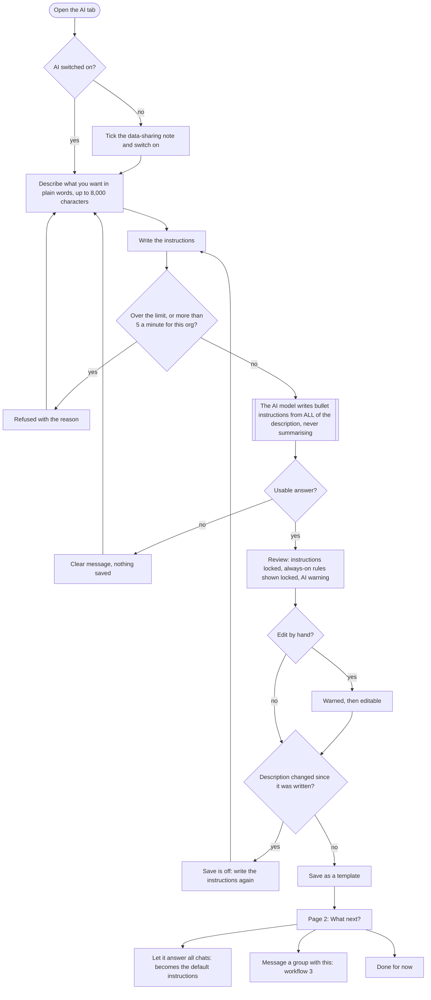
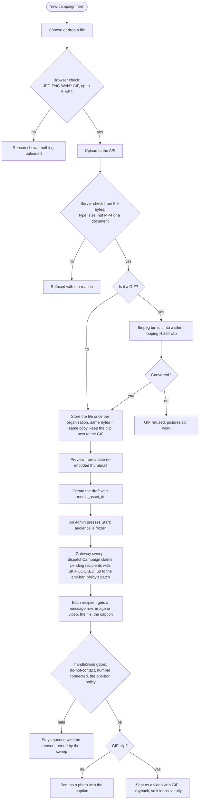
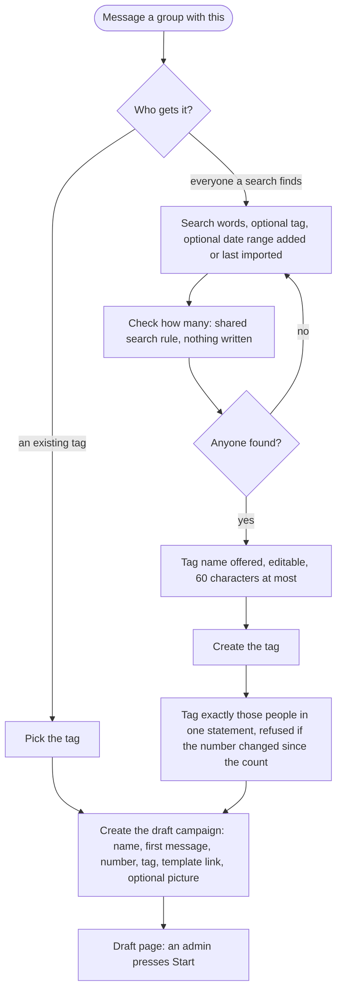
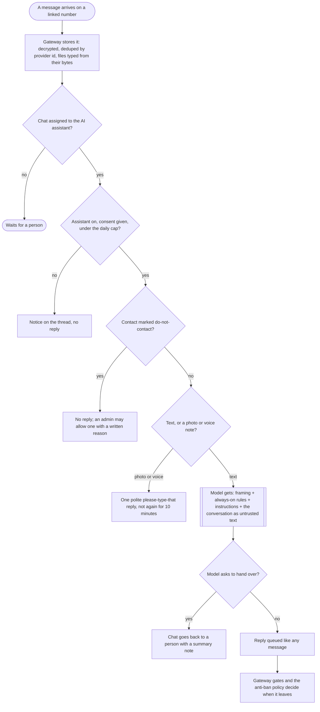
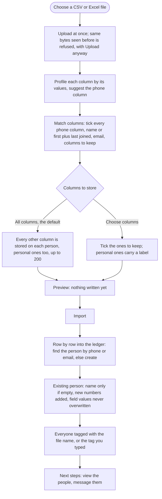
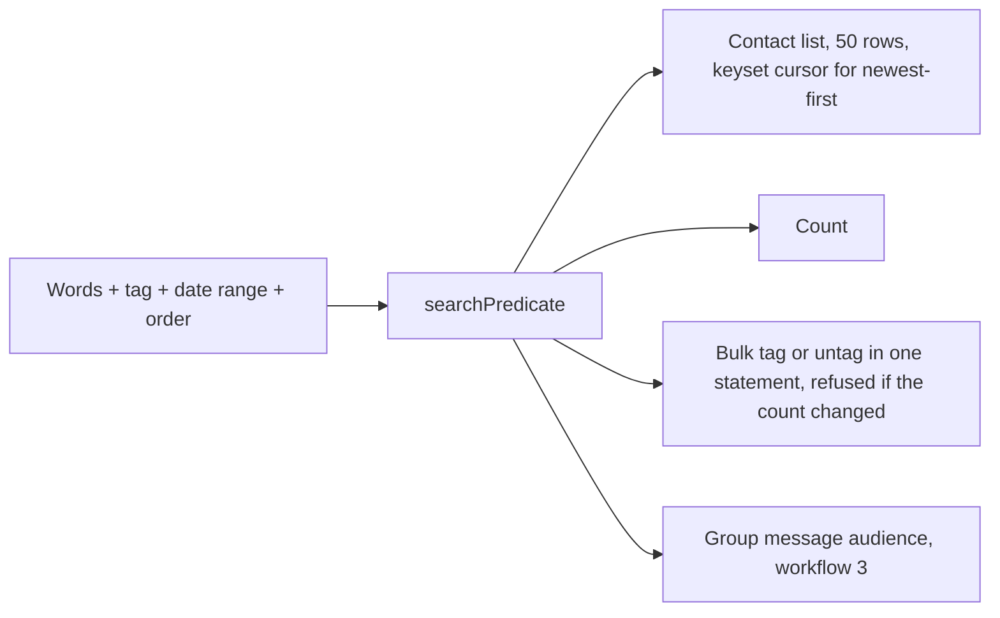
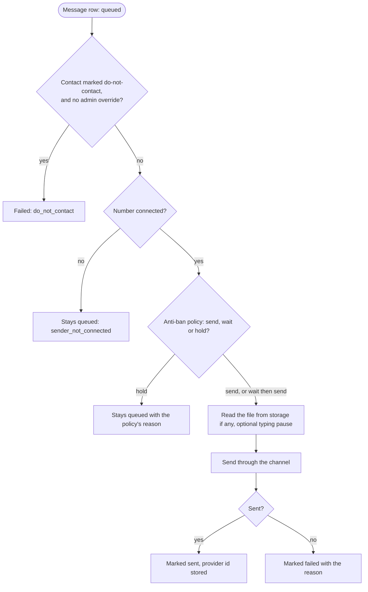
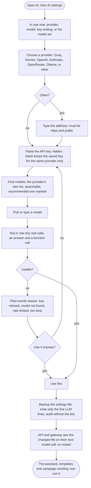

# 36 · Workflows

How the main things work, as diagrams. Written 2026-10-21 from the code as built (what is **not** built is
marked). The diagrams are [Mermaid](https://mermaid.js.org): they draw themselves on GitHub and in most Markdown
viewers. Legend: rounded boxes are steps, diamonds are decisions, the shaded boxes are the AI model.

## 1 · AI templates: describe it, review, save, use

Page 1 is `/ai`; saving moves to page 2, `/ai/t/<id>`. (Code: `apps/web/app/ai/`, `packages/core/src/ai-templates.ts`.)

**What the assistant is told when it replies** (every time, in this order): the app's fixed framing, then the
**always-on rules** (locked, same for every template, added in `systemText` so editing cannot remove them), then the
instructions, then the conversation, which is treated as untrusted. The description is never sent to the reply model.

## 2 · A campaign with a picture or GIF

(Code: `packages/core/src/campaign-media.ts`, `media-convert.ts`, `campaigns.ts`, `apps/gateway/src/work.ts`,
`packages/channels/baileys/src/outbound-content.ts`.)

## 3 · Message a group from a template (the tag rule)

Every mass message goes to a tag (D-87). The tag name is `<template>-N (date, time)` and editable.
(Code: `apps/web/app/ai/t/[id]/group-section.tsx`, `apps/web/app/ai/actions.ts`.)

## 4 · An inbound message answered by the AI assistant

(Code: `packages/core/src/ai-reply.ts`, `apps/gateway/src/main.ts`.) Only chats **assigned to the assistant** are answered.

## 5 · Importing contacts

(Code: `apps/web/app/import/`, `packages/core/src/ingestion.ts`.) The extra columns are stored as one JSON object on the contact (`contact.custom_fields`, a `jsonb` column with a search index, docs/35), not as a database column each, so any number of sheet columns fit.

## 6 · One search rule for the list, the count and bulk tagging

## 7 · The send pipeline for every outbound message

All sends, text or picture, human or AI or campaign, end here. (Code: `handleSend` in `apps/gateway/src/work.ts`;
the rules are in [`08-antiban.md`](08-antiban.md).)

The only policy for now (`basicPolicy`) never holds: it makes a send wait out the rest of a random 3 to 8 second gap since the number's last send.

## 8 · Choosing the AI: the AI settings tab

Second tab inside the AI tab, `/ai/settings`. (Code: `apps/web/app/ai/settings/`, `apps/api/src/routes/ai.ts`, `packages/providers/llm/src/`.) Admin only.

## AI campaigns: who writes the first message

A campaign made from an AI template (AI page → "Message a group") does not send its typed text. The gateway asks the AI to write one opening per person from the template's instructions, the person's name and stored columns, and the typed text as an outline. Only people with an opening are queued, and the AI's text is what goes out; the rest of the pipeline (the anti-ban policy, do-not-contact) is unchanged. If the AI is off, or no model is set, those campaigns wait. After three failed writes a person is skipped as `ai_opening_failed`. Code: `packages/core/src/ai-opening.ts`, `dispatchCampaign`, `apps/gateway/src/work.ts`.
